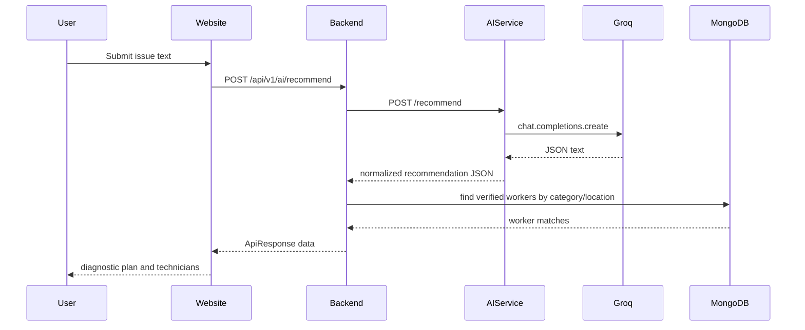
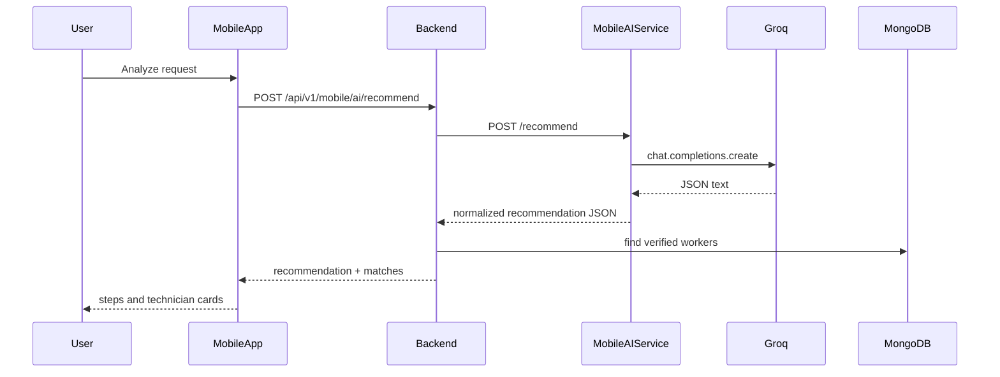
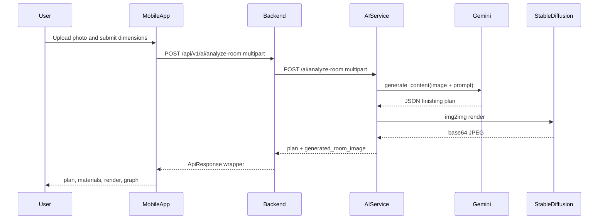

# AI Service Audit Report

Audit date: 2026-05-19

Scope inspected:
- `ai-service`
- backend AI gateway and route mounting
- Flutter mobile AI API, screens, state, tests
- website Smart Match, estimator, API client, and static chat widget

Search basis: targeted code search for AI service names, model/provider names, routes, env vars, prompt construction, streaming keywords, embeddings/vector/RAG keywords, and frontend/mobile call paths. Hidden worktrees, `.git`, `.dart_tool`, `node_modules`, and `ai-service/venv` were excluded.

Targeted search found 62 AI-related candidate files. This report maps the materially relevant implementation, config, dev UI, and test files; repeated static HTML pages that only embed the same non-network chat widget are summarized once.

## 1. Executive Summary

Servio uses AI in three main ways:

1. Smart Match: user free text is sent from website/mobile to the Node backend, then to a Python Groq-based recommender. The recommender classifies the home-service issue, extracts location/budget/time, returns a normalized JSON result, and the Node backend enriches it with matching verified workers from MongoDB.
2. AI Room Finisher: mobile uploads a room photo plus dimensions and budget to the Node backend, which forwards multipart form data to `ai-service`. The Python service sends the image and measurement prompt to Google Gemini, then optionally runs a local Stable Diffusion img2img render and returns a finishing plan plus base64 image.
3. Cost Estimator: website and mobile estimator screens mainly run deterministic local cost formulas. They optionally call Smart Match to fetch recommended technicians for the generated finishing description.

Main AI providers/models:
- Groq Chat Completions using `llama-3.3-70b-versatile` for Smart Match.
- Google GenAI/Gemini using `gemini-2.5-flash`, fallback to `gemini-2.0-flash`, fallback to `gemini-1.5-flash` for room photo analysis.
- Local Diffusers pipeline loading `runwayml/stable-diffusion-v1-5` for room render generation.
- Legacy/unmounted `room_finishing` code references Groq vision model `meta-llama/llama-4-scout-17b-16e-instruct`.

Centralization:
- AI provider calls are mostly centralized in `ai-service`, with Node acting as a gateway.
- However, there is duplication: `ai_recommender/api.py` and `ai_recommender_mobile/api.py` are near-duplicates, `backend/src/modules/ai/ai.controller.js` and `ai.mobile.controller.js` duplicate matching/post-processing logic, and there is an unmounted `room_finishing` implementation that overlaps with the active `routes/room_analysis.py` flow.

Major risks and unclear areas:
- `POST /api/v1/ai/recommend` is public and proxies to paid AI with no rate limit found (`backend/src/modules/ai/ai.routes.js:20-21`).
- Mobile sends `include_render`, but the backend does not forward it to `ai-service`, so clients cannot disable the expensive Stable Diffusion render (`mobile-app/lib/src/core/api/ai_api.dart:42-49`, `backend/src/modules/ai/ai.controller.js:229-245`).
- No streaming is implemented; all UIs wait for full responses.
- Gemini output is prompt-constrained JSON but not schema-validated before UI parsing (`ai-service/services/gemini_service.py:173-184`).
- Stable Diffusion disables the safety checker (`ai-service/services/stable_diffusion_service.py:20-24`).
- `AI_SERVICE_URL` is required by backend Smart Match and room analysis but has no code default in `ai.controller.js` (`backend/src/modules/ai/ai.controller.js:193-196`, `backend/src/modules/ai/ai.controller.js:247-254`).

## 2. Directory and File Map

| File | Area | Purpose | Main classes/functions | Importance |
| --- | --- | --- | --- | --- |
| `ai-service/main.py` | AI backend | FastAPI app, CORS, route mounting | `app`, `health_check` | Critical |
| `ai-service/routes/smart_recommend.py` | AI backend | Mounts `/recommend`, forwards to Groq recommender | `smart_recommend`, `SmartRecommendRequest` | Critical |
| `ai-service/ai_recommender/api.py` | AI backend | Smart Match model prompt, Groq call, normalization rules | `SYSTEM_PROMPT`, `recommend`, `_normalize_model_result` | Critical |
| `ai-service/ai_recommender_mobile/api.py` | AI backend | Duplicate/mobile variant of Smart Match recommender | `SYSTEM_PROMPT`, `recommend` | Critical if `AI_MOBILE_SERVICE_URL` points here |
| `ai-service/ai_recommender/ui.py` | Dev UI | Gradio UI and local API launcher for recommender | `_call_api`, `handle_submit` | Dev/support |
| `ai-service/ai_recommender_mobile/ui.py` | Dev UI | Duplicate/mobile Gradio UI | `_call_api`, `handle_submit` | Dev/support |
| `ai-service/ai_recommender/start-dev.ps1` | Dev tooling | Starts recommender API on port 8001 | PowerShell launcher | Dev/support |
| `ai-service/ai_recommender_mobile/start-dev.ps1` | Dev tooling | Starts mobile recommender API on port 8001 | PowerShell launcher | Dev/support |
| `ai-service/routes/room_analysis.py` | AI backend | Active room analysis endpoint | `analyze_room_endpoint` | Critical |
| `ai-service/services/gemini_service.py` | AI backend | Gemini client, prompt, fallback chain, JSON parsing | `_generate_with_fallback`, `analyze_room` | Critical |
| `ai-service/services/stable_diffusion_service.py` | AI backend | Local Stable Diffusion img2img render generation | `build_prompt`, `generate_finished_room` | Critical for render |
| `ai-service/utils/image_utils.py` | AI backend | Resize/validate uploaded images | `prepare_image`, `prepare_image_for_sd`, `validate_image` | High |
| `ai-service/routes/cost_estimator.py` | AI backend | Deterministic room cost endpoint | `estimate_cost`, `PRICE_TABLE` | Medium, no LLM |
| `ai-service/routes/recommendation.py` | AI backend | Older mock provider recommendation endpoint | `recommend_endpoint` | Low/legacy |
| `ai-service/services/recommendation_service.py` | AI backend | Numeric cosine-similarity provider ranking | `recommend_providers` | Low/legacy |
| `ai-service/services/vendor_enrichment.py` | AI backend | Intended DB vendor enrichment, not imported elsewhere | `enrich_with_vendors` | Low/inactive |
| `ai-service/room_finishing/routes/room_analysis.py` | AI backend | Unmounted alternative room analysis route | `analyze_room_endpoint` | Low/inactive |
| `ai-service/room_finishing/services/gemini_service.py` | AI backend | Unmounted Groq vision implementation | `SYSTEM_PROMPT`, `analyze_room` | Low/inactive |
| `ai-service/room_finishing/utils/image_utils.py` | AI backend | Unmounted image preprocessing | `prepare_image`, `validate_image` | Low/inactive |
| `ai-service/room-analyzer.html` | Dev/test UI | Direct browser test against `ai-service` `/ai/analyze-room` | `analyze`, `renderResults` | Dev/support |
| `ai-service/room-analyzer-test.html` | Dev/test UI | Browser test through backend auth and `/api/v1/ai/analyze-room` | `login`, `analyze`, `renderResults` | Dev/support |
| `ai-service/extract_image.py` | Dev utility | Extracts base64 render from response JSON | script body | Dev/support |
| `ai-service/requirements.txt` | Config | Python AI dependencies | Groq, Google GenAI, Diffusers, Torch | Critical |
| `backend/src/modules/ai/ai.routes.js` | Backend | Website/backend AI routes | `/recommend`, `/analyze-room`, multer | Critical |
| `backend/src/modules/ai/ai.controller.js` | Backend | Gateway to Python AI plus worker matching | `getServiceRecommendation`, `analyzeRoom`, `findMatchingWorkers` | Critical |
| `backend/src/modules/ai/ai.mobile.routes.js` | Backend | Mobile AI route mount under `/mobile/ai` | `/recommend` | Critical for mobile |
| `backend/src/modules/ai/ai.mobile.controller.js` | Backend | Mobile Smart Match gateway | `getMobileRecommendation` | Critical for mobile |
| `backend/src/app.js` | Backend | Mounts AI routes under `/api/v1` | `app.use('/api/v1/ai')`, `app.use('/api/v1/mobile/ai')` | Critical |
| `backend/__tests__/ai.controller.test.js` | Tests | Mocks AI responses and verifies location/category post-processing | Jest tests | High |
| `mobile-app/lib/src/core/api/ai_api.dart` | Mobile | AI API client wrapper and response models | `AiApi.recommend`, `AiApi.analyzeRoom` | Critical |
| `mobile-app/lib/src/core/api/api_endpoints.dart` | Mobile | Endpoint constants | `aiRecommend`, `aiAnalyzeRoom` | Critical |
| `mobile-app/lib/src/core/api/api_client.dart` | Mobile | JSON and multipart HTTP client, auth headers, timeouts | `post`, `postMultipart` | High |
| `mobile-app/lib/src/core/api/api_config.dart` | Mobile | Backend URL from dart defines | `baseUrl`, `normalizeBackendUrl` | High |
| `mobile-app/lib/src/app.dart` | Mobile | Registers `RoomFinishingProvider` with `AiApi` | `MultiProvider` setup | High |
| `mobile-app/lib/src/core/state/room_finishing_provider.dart` | Mobile | AI room analysis state machine, timing, cancellation | `analyze`, `cancel` | Critical |
| `mobile-app/lib/src/core/state/ai_performance_tracker.dart` | Mobile | In-memory timing metrics; no prompts/responses stored | `AiPerformanceTracker` | Medium |
| `mobile-app/lib/src/core/knowledge/finishing_knowledge_graph.dart` | Mobile | Converts finishing response to nodes/edges | `FinishingKnowledgeGraph.fromAnalysis` | Medium |
| `mobile-app/lib/src/features/customer/ai_smart_match_screen.dart` | Mobile | Customer Smart Match UI | `_analyze` | Critical |
| `mobile-app/lib/src/features/customer/ai_finishing_estimator_screen.dart` | Mobile | Deterministic estimator and optional AI tech recommendations | `calcCosts`, `_loadTechs` | High |
| `mobile-app/lib/src/features/customer/ai_room_finisher_screen.dart` | Mobile | Room photo AI analysis UI | `_pickImage`, submit handler | Critical |
| `mobile-app/lib/src/features/customer/customer_shell.dart` | Mobile | Smart Match bottom nav tab | `pages` includes `AiSmartMatchScreen` | Medium |
| `mobile-app/lib/src/features/customer/customer_home_screen.dart` | Mobile | Home shortcuts to AI screens | navigation callbacks | Medium |
| `mobile-app/lib/src/features/customer/customer_dashboard_screen.dart` | Mobile | Dashboard shortcut to estimator | navigation callback | Low |
| `mobile-app/lib/src/features/dev/ai_performance_dashboard.dart` | Mobile | Debug-only AI performance dashboard | charts/timing list | Medium |
| `mobile-app/test/core/api/ai_api_analyze_room_test.dart` | Tests | Multipart room-analysis API test | `analyzeRoom posts multipart...` | High |
| `mobile-app/test/features/customer/ai_estimator_logic_test.dart` | Tests | Deterministic estimator formula tests | `calcCosts`, `calcMaterials` | Medium |
| `mobile-app/test/core/knowledge/finishing_knowledge_graph_test.dart` | Tests | Knowledge graph mapping tests | graph assertions | Medium |
| `servio_frontend/js/api/ai.js` | Website | AI API wrapper | `smartMatch`, `recommendService` | Critical |
| `servio_frontend/js/api/client.js` | Website | JSON fetch wrapper, auth headers, response unwrap | `request`, `api.post` | High |
| `servio_frontend/js/config.js` | Website | Backend base URL | `window.SERVIO_CONFIG.API_BASE` | High |
| `servio_frontend/js/html/smart-match.js` | Website | Smart Match page behavior, call/render/error handling | click handler, `renderSmartMatch` | Critical |
| `servio_frontend/html/smart-match.html` | Website | Smart Match page shell | form/textarea/results containers | High |
| `servio_frontend/css/pages/ai-match.css` | Website | Smart Match UI styling | CSS classes | Medium |
| `servio_frontend/js/html/ai-estimator.js` | Website | Deterministic estimator plus tech recommendation call | `calcCosts`, `renderRecommendedTechnicians` | High |
| `servio_frontend/html/ai-estimator.html` | Website | Estimator page shell | wizard/results containers | High |
| `servio_frontend/css/pages/ai-estimator.css` | Website | Estimator UI styling | CSS classes | Medium |
| `servio_frontend/js/components/chat-widget.js` | Website | Static chat widget simulation; no network call | `initChatWidget` | Low |
| `servio_frontend/css/components/chat-widget.css` | Website | Chat widget styling | CSS classes | Low |
| `servio_frontend/js/main.js` | Website | Initializes chat widget globally | `initChatWidget` call | Low |

Repeated static chat-widget markup appears in multiple website HTML pages. It is AI-branded but not connected to an AI API; `chat-widget.js` appends a fixed canned reply after 450 ms (`servio_frontend/js/components/chat-widget.js:72-86`).

## 3. AI Providers and APIs

| Provider/API | Endpoint/SDK/package | Files | Request method | Auth | Server/client side | Used by |
| --- | --- | --- | --- | --- | --- | --- |
| Groq Chat Completions | `groq.Groq`, `client.chat.completions.create` | `ai-service/ai_recommender/api.py:386-387`, `ai-service/ai_recommender/api.py:1097-1105`; duplicate mobile at `ai-service/ai_recommender_mobile/api.py:404-405`, `ai-service/ai_recommender_mobile/api.py:1115-1122` | SDK call | `GROQ_API_KEY`; value not printed | Server-side Python | Smart Match |
| Google Gemini | `google.genai`, `Client.models.generate_content` | `ai-service/services/gemini_service.py:1-2`, `ai-service/services/gemini_service.py:27-34`, `ai-service/services/gemini_service.py:51-55` | SDK call | `GEMINI_API_KEY`; value not printed | Server-side Python | Room photo analysis |
| Local Diffusers/Hugging Face model | `StableDiffusionImg2ImgPipeline.from_pretrained` | `ai-service/services/stable_diffusion_service.py:1`, `ai-service/services/stable_diffusion_service.py:20-24` | Local model load/inference | No API key in active code; `HF_TOKEN` exists in `ai-service/.env` variable names but was not referenced by code search | Server-side Python | Room render |
| Internal Python AI service | FastAPI routes `/recommend`, `/ai/analyze-room`, `/ai/estimate-cost`, `/ai/recommend` | `ai-service/main.py:34-37`, `ai-service/main.py:45-49` | HTTP POST | No auth in `ai-service`; backend protects some routes | Internal server API | Backend gateway, dev test UIs |
| Node AI gateway | Express routes under `/api/v1/ai` and `/api/v1/mobile/ai` | `backend/src/app.js:87-88` | HTTP POST | `/api/v1/ai/analyze-room` uses `protect`; `/api/v1/ai/recommend` is public | Server-side gateway exposed to clients | Website/mobile |

No OpenAI, Anthropic, Claude, Mistral, Together, Replicate, Ollama, Pinecone, Supabase vector, pgvector, LangChain, or LlamaIndex code paths were found.

## 4. Models Inventory

| Model | Provider | Purpose | File/line | Parameters | Production/test/fallback |
| --- | --- | --- | --- | --- | --- |
| `llama-3.3-70b-versatile` | Groq | Smart Match natural-language classification/extraction | `ai-service/ai_recommender/api.py:1097-1105`; duplicate `ai-service/ai_recommender_mobile/api.py:1115-1122` | `temperature=0.1`, `response_format={"type":"json_object"}` | Active if `/recommend` service is used |
| `gemini-2.5-flash` | Google Gemini | Preferred room image finishing analysis | `ai-service/services/gemini_service.py:14-18`, `ai-service/services/gemini_service.py:27-34` | `system_instruction=SYSTEM_PROMPT`; no temperature/max tokens set in active Gemini SDK call | Active preferred model |
| `gemini-2.0-flash` | Google Gemini | Fallback room analysis | `ai-service/services/gemini_service.py:14-18`, `ai-service/services/gemini_service.py:40-43` | Same config as preferred; tried after transient 503/429/overload | Fallback |
| `gemini-1.5-flash` | Google Gemini | Final fallback room analysis | `ai-service/services/gemini_service.py:14-18` | Same config as preferred | Fallback |
| `runwayml/stable-diffusion-v1-5` | Local Diffusers/HF model | Room render generation | `ai-service/services/stable_diffusion_service.py:20-24` | `strength=0.65`, `guidance_scale=7.5`, `num_inference_steps=30 GPU/15 CPU`, size 768x512 GPU or 512x512 CPU | Active render path |
| `meta-llama/llama-4-scout-17b-16e-instruct` | Groq | Legacy/unmounted room vision analysis | `ai-service/room_finishing/services/gemini_service.py:8-10`, `ai-service/room_finishing/services/gemini_service.py:141-164` | `max_tokens=4096`, `temperature=0.2` | Inactive/unmounted code |

No `top_p`, tool definitions, streaming flags, or embedding models were found.

## 5. Prompt Inventory

| Prompt | File/line | Type | Purpose | Inputs | Safety/format instructions | Shared? |
| --- | --- | --- | --- | --- | --- | --- |
| Smart Match `SYSTEM_PROMPT` | `ai-service/ai_recommender/api.py:297-384`; duplicate mobile `ai-service/ai_recommender_mobile/api.py:307-401` | System prompt | Classify English/Arabic home-service request into allowed services, confidence, extracted fields, top 3, steps, advisor message | User prompt text | JSON-only, grounded facts, allowed services, disambiguation rules, water/electrical safety rule | Shared concept, duplicated files |
| Smart Match user prompt | `ai-service/ai_recommender/api.py:1097-1105` | User prompt | Raw user request | `request.prompt` | `response_format=json_object` constrains model response | Website/mobile through backend |
| Gemini room analysis `SYSTEM_PROMPT` | `ai-service/services/gemini_service.py:57-139` | System instruction | Produce Egyptian room finishing plan with three tiers | Room image plus dimensions/budget/style | Single valid JSON object, no markdown, EGP, quantities from dimensions, 10% waste | Active room finisher |
| Gemini room analysis user prompt | `ai-service/services/gemini_service.py:155-171` | User/context prompt | Provides measurements, floor/wall area, budget, style | `length_m`, `width_m`, `height_m`, computed areas, `budget_egp`, `style_preference` | Requests all 3 plans and market prices | Active room finisher |
| Stable Diffusion prompt | `ai-service/services/stable_diffusion_service.py:37-68` | Image generation prompt and negative prompt | Create polished render from Gemini plan | `room_type`, plan style, material names | Negative prompt excludes unfinished/low-quality/people/text/watermarks | Active render |
| Legacy Groq room finishing prompt | `ai-service/room_finishing/services/gemini_service.py:16-99`, user prompt at `ai-service/room_finishing/services/gemini_service.py:117-137` | System/user prompts | Older room finishing plan through Groq vision | Image base64, dimensions, budget, style | Valid JSON only, all 3 plans, EGP | Inactive/unmounted |
| Estimator Smart Match description | Mobile: `mobile-app/lib/src/features/customer/ai_finishing_estimator_screen.dart:971-977`; Website: `servio_frontend/js/html/ai-estimator.js:355-358` | User prompt | Ask Smart Match for technicians after deterministic estimate | room type, finish level, area | None beyond Smart Match prompt | Platform-specific |

Long prompt text is summarized rather than copied verbatim.

## 6. AI Request Flow

### Website Smart Match

Evidence:
- Page imports `smartMatch` (`servio_frontend/js/html/smart-match.js:1`).
- Submit handler reads textarea and calls `smartMatch({ prompt, location })` (`servio_frontend/js/html/smart-match.js:330-357`).
- API wrapper posts `/ai/recommend` (`servio_frontend/js/api/ai.js:3-4`).
- Website API client adds bearer token if present and unwraps backend envelopes (`servio_frontend/js/api/client.js:37-59`).
- Backend mounts `/api/v1/ai` (`backend/src/app.js:87`), and route `/recommend` is public (`backend/src/modules/ai/ai.routes.js:20-21`).
- Backend posts to Python `${AI_SERVICE_URL}/recommend` with 15 second timeout (`backend/src/modules/ai/ai.controller.js:193-197`).
- Python route `/recommend` forwards to Groq recommender (`ai-service/routes/smart_recommend.py:12-15`).
- Groq response is parsed and normalized (`ai-service/ai_recommender/api.py:1097-1114`, `ai-service/ai_recommender/api.py:967-1058`).
- Backend queries workers by mapped categories and location (`backend/src/modules/ai/ai.controller.js:82-122`).
- UI renders scenario-specific result cards/technician stage (`servio_frontend/js/html/smart-match.js:389-445`).

### Mobile Smart Match

Evidence:
- `CustomerShell` includes `AiSmartMatchScreen` in the main customer tabs (`mobile-app/lib/src/features/customer/customer_shell.dart:56-60`).
- `_analyze` sends description/location/budget to `AiApi.recommend` (`mobile-app/lib/src/features/customer/ai_smart_match_screen.dart:68-101`).
- `AiApi.recommend` posts to `/mobile/ai/recommend` (`mobile-app/lib/src/core/api/ai_api.dart:11-23`; endpoint at `mobile-app/lib/src/core/api/api_endpoints.dart:38`).
- Backend mounts `/api/v1/mobile/ai` (`backend/src/app.js:88`).
- Mobile backend controller posts to `AI_MOBILE_SERVICE_URL || http://localhost:8001` (`backend/src/modules/ai/ai.mobile.controller.js:157-164`), then applies the same worker matching/post-processing (`backend/src/modules/ai/ai.mobile.controller.js:166-175`).

### Mobile AI Room Finisher

Evidence:
- `RoomFinishingProvider` is registered globally with `AiApi` (`mobile-app/lib/src/app.dart:78-80`).
- UI picks image and stores bytes in provider (`mobile-app/lib/src/features/customer/ai_room_finisher_screen.dart:51-63`).
- Submit calls `provider.analyze` (`mobile-app/lib/src/features/customer/ai_room_finisher_screen.dart:127-133`).
- Provider calls `AiApi.analyzeRoom` (`mobile-app/lib/src/core/state/room_finishing_provider.dart:158-170`).
- `AiApi.analyzeRoom` uploads multipart image, dimensions, budget, style, include_render (`mobile-app/lib/src/core/api/ai_api.dart:40-58`).
- Backend route is authenticated and uses memory multer with 10 MB image limit (`backend/src/modules/ai/ai.routes.js:11-24`).
- Backend forwards multipart to `${AI_SERVICE_URL}/ai/analyze-room` with 180 second timeout (`backend/src/modules/ai/ai.controller.js:236-258`).
- Python validates file type/size/image and dimensions (`ai-service/routes/room_analysis.py:24-42`).
- Python calls Gemini and then optional Stable Diffusion render (`ai-service/routes/room_analysis.py:44-76`).
- Mobile parses nested backend/FastAPI response and base64 render (`mobile-app/lib/src/core/api/ai_api.dart:279-315`), then builds a knowledge graph (`mobile-app/lib/src/core/state/room_finishing_provider.dart:204-206`).

### Website/Mobile Estimator

The estimator does not call an AI model for pricing. It calculates costs locally:
- Website: `calcCosts` uses hardcoded rates and multipliers (`servio_frontend/js/html/ai-estimator.js:285-304`).
- Mobile: `calcCosts` is a Dart port of website logic (`mobile-app/lib/src/features/customer/ai_finishing_estimator_screen.dart:68-86`).

Both can call Smart Match afterward to recommend technicians:
- Website: `renderRecommendedTechnicians` imports `recommendService` and posts a generated description (`servio_frontend/js/html/ai-estimator.js:351-359`).
- Mobile: `_loadTechs` calls `AiApi.recommend` with a generated finishing description (`mobile-app/lib/src/features/customer/ai_finishing_estimator_screen.dart:968-977`).

## 7. Streaming Behavior

Streaming is not implemented.

Evidence:
- Groq calls do not pass `stream=True`; they wait for `response.choices[0].message.content` (`ai-service/ai_recommender/api.py:1097-1108`; duplicate mobile at `ai-service/ai_recommender_mobile/api.py:1115-1126`).
- Gemini uses synchronous `models.generate_content`, not a streaming variant (`ai-service/services/gemini_service.py:27-34`).
- Stable Diffusion returns a finished image after local inference (`ai-service/services/stable_diffusion_service.py:92-105`).
- Backend uses `axios.post` and returns after full upstream response (`backend/src/modules/ai/ai.controller.js:193-208`, `backend/src/modules/ai/ai.controller.js:247-265`).
- Mobile `postMultipart` converts the HTTP stream into a full `http.Response.fromStream` before returning (`mobile-app/lib/src/core/api/api_client.dart:72-75`).
- Website uses `fetch` plus `await res.json()` (`servio_frontend/js/api/client.js:45-46`).

Partial token/chunk rendering: Not found.

Fallback if streaming fails: Not applicable.

Performance implication: users wait for full completion, especially for room analysis and render. Mobile mitigates perception with elapsed-time UI and cancellation-discard logic, but the underlying HTTP request continues (`mobile-app/lib/src/core/state/room_finishing_provider.dart:102-113`).

## 8. Data and Context Sent to AI

Smart Match sends:
- User-provided prompt/description (`backend/src/modules/ai/ai.controller.js:185-195`; mobile at `backend/src/modules/ai/ai.mobile.controller.js:150-162`).
- Location is sent from clients to Node, but Node does not forward location to Python AI; it uses location only for worker matching/post-processing (`backend/src/modules/ai/ai.controller.js:185-201`).
- Budget is sent by mobile as a field to Node (`mobile-app/lib/src/core/api/ai_api.dart:17-21`) but backend only forwards `{ prompt }`, so budget is not sent to Groq unless embedded in the prompt (`backend/src/modules/ai/ai.mobile.controller.js:150-164`). Same for website generated descriptions.

Room analysis sends:
- Uploaded room image bytes to Node, then to Python (`mobile-app/lib/src/core/api/ai_api.dart:40-55`; `backend/src/modules/ai/ai.controller.js:236-249`).
- Image bytes to Gemini after resize to max side 1600 (`ai-service/routes/room_analysis.py:45-53`; `ai-service/utils/image_utils.py:5-20`).
- Original image bytes resized to Stable Diffusion dimensions if render is enabled (`ai-service/routes/room_analysis.py:56-70`; `ai-service/utils/image_utils.py:23-29`).
- Dimensions, computed floor/wall area, budget, and style preference in the Gemini user prompt (`ai-service/services/gemini_service.py:152-171`).

Data not found:
- No conversation history.
- No uploaded documents other than room images.
- No profile/preferences sent directly to external AI models.
- No database records sent to external AI models.
- No RAG retrieval context.
- No metadata beyond prompt/image/dimensions/budget/style.

Sensitive/excessive-data flags:
- Room images are sent to Google Gemini, and generated render uses local Stable Diffusion. This is potentially sensitive household imagery.
- Smart Match prompt may include user-entered address/location, budget, and problem details. Location is not forwarded separately by backend, but if users type it in the prompt it goes to Groq.
- Website keeps `lastSmartMatchRender = { data, resultsArea, prompt }` in memory (`servio_frontend/js/html/smart-match.js:389-391`); this is not persisted, but the prompt remains in JS memory for re-rendering.

## 9. RAG, Embeddings, and Vector Search

No RAG/vector database implementation was found.

Evidence:
- Searches for embeddings, vector DBs, Pinecone, Supabase vector, pgvector, LangChain, and LlamaIndex found no active implementation.
- `ai-service/services/recommendation_service.py` uses plain numeric vectors and scikit-learn cosine similarity for provider ranking (`ai-service/services/recommendation_service.py:5-13`, `ai-service/services/recommendation_service.py:48-59`). This is not an embedding model or vector database.
- `mobile-app/lib/src/core/knowledge/finishing_knowledge_graph.dart` converts an AI response into typed nodes/edges for UI/export (`mobile-app/lib/src/core/knowledge/finishing_knowledge_graph.dart:72-200`), but it is not retrieval or vector search.

Embedding models: Not found.
Vector database: Not found.
Chunking/retrieval/reranking: Not found.

## 10. Tools, Agents, and Function Calling

Function calling/tools/agents: Not found.

Structured outputs:
- Groq Smart Match uses `response_format={"type": "json_object"}` (`ai-service/ai_recommender/api.py:1103-1104`; duplicate mobile at `ai-service/ai_recommender_mobile/api.py:1121-1122`).
- Gemini room analysis relies on prompt-only JSON instructions and `json.loads` after stripping fences (`ai-service/services/gemini_service.py:65-73`, `ai-service/services/gemini_service.py:175-184`).
- Legacy Groq room finishing uses prompt JSON plus normal chat completions parameters, not a formal JSON schema (`ai-service/room_finishing/services/gemini_service.py:141-164`).

Tool routers/multi-step reasoning/background jobs: Not found.

Validation risks:
- Smart Match has strong normalization to allowed services and computed scenario fields (`ai-service/ai_recommender/api.py:967-1058`).
- Gemini room analysis only parses JSON; no schema validation was found to guarantee required keys/types before later code indexes `result["finishing_plans"]` (`ai-service/routes/room_analysis.py:60-64`).

## 11. Error Handling and Fallbacks

Smart Match:
- Empty prompt returns a local error response before model call (`ai-service/ai_recommender/api.py:1070-1076`).
- Unrecognized or vague prompts can return local fallback responses without calling Groq (`ai-service/ai_recommender/api.py:1078-1094`).
- Groq errors are returned as `{"error": "AI error: ..."}` by Python (`ai-service/ai_recommender/api.py:1116-1117`).
- Backend maps upstream timeout to 504, upstream response to 502, and connection errors to 503 (`backend/src/modules/ai/ai.controller.js:209-217`; mobile at `backend/src/modules/ai/ai.mobile.controller.js:176-184`).
- Frontend Smart Match renders a service-unavailable card (`servio_frontend/js/html/smart-match.js:358-360`, `servio_frontend/js/html/smart-match.js:863-870`).
- Mobile Smart Match shows `ApiException.message` or generic "AI service unavailable" (`mobile-app/lib/src/features/customer/ai_smart_match_screen.dart:94-101`).

Room analysis:
- Backend rejects missing image or required fields (`backend/src/modules/ai/ai.controller.js:224-233`).
- Backend forwards upstream timeout/response/connectivity errors (`backend/src/modules/ai/ai.controller.js:266-276`).
- Python validates content type, file size, actual image file, dimensions, and budget (`ai-service/routes/room_analysis.py:24-42`).
- Python maps JSON parsing failure to a 500 and other exceptions to `Analysis failed: ...` (`ai-service/routes/room_analysis.py:78-81`).
- Gemini fallback chain retries only transient overload/rate-limit/unavailable messages and sleeps between models (`ai-service/services/gemini_service.py:21-45`).
- Mobile room provider records success/failure timing and surfaces API or unexpected errors (`mobile-app/lib/src/core/state/room_finishing_provider.dart:180-237`).

Gaps:
- No explicit retry for Groq Smart Match.
- No timeout wrapper around Gemini SDK call in `gemini_service.py`.
- No schema validation for Gemini room-analysis output.
- No rate-limit handling at the public backend Smart Match route.
- `vendor_enrichment.py` swallows exceptions silently (`ai-service/services/vendor_enrichment.py:34-36`) and is not used by active room analysis.

## 12. Performance Analysis

Ranked by impact and confidence:

1. High impact, high confidence: Stable Diffusion render is expensive and blocks the request. The active route runs Gemini first, then Stable Diffusion if `include_render` is true (`ai-service/routes/room_analysis.py:44-76`). Local CPU mode uses fewer steps but is still slow (`ai-service/services/stable_diffusion_service.py:11-16`).
2. High impact, high confidence: Mobile cannot actually disable render through the backend because `include_render` is not forwarded. Mobile sends it (`mobile-app/lib/src/core/api/ai_api.dart:42-49`), but backend only forwards image, dimensions, budget, and style (`backend/src/modules/ai/ai.controller.js:236-245`).
3. High impact, high confidence: No streaming or progress events. Clients wait for full JSON/image completion; mobile only shows elapsed time.
4. Medium impact, high confidence: Stable Diffusion model loads at Python import/startup (`ai-service/services/stable_diffusion_service.py:18-24`), which increases cold start and memory use even before an analysis request.
5. Medium impact, medium confidence: Gemini fallback can add serial delay (`time.sleep(1.5 * (idx + 1))`) before trying later models (`ai-service/services/gemini_service.py:40-43`).
6. Medium impact, high confidence: Backend Smart Match timeout is only 15 seconds (`backend/src/modules/ai/ai.controller.js:193-197`; mobile at `backend/src/modules/ai/ai.mobile.controller.js:160-164`), which may be too short during cold starts or Groq latency spikes.
7. Medium impact, high confidence: Website and mobile estimator perform deterministic calculation first, then make a separate Smart Match call for technicians (`servio_frontend/js/html/ai-estimator.js:351-359`, `mobile-app/lib/src/features/customer/ai_finishing_estimator_screen.dart:968-977`).
8. Low/medium impact, medium confidence: No caching was found for identical Smart Match prompts or room analysis requests.

## 13. Security and Privacy Review

Positive findings:
- No real API key values are printed in this report.
- Targeted secret scan did not find committed OpenAI/Groq/Gemini-style secret strings in source. The only key-like match was a placeholder guard (`ai-service/services/gemini_service.py:52`).
- `.gitignore` excludes `.env` and `.env.*` while allowing examples (`.gitignore:21-26`).
- Room analysis route in backend requires auth (`backend/src/modules/ai/ai.routes.js:23-24`).
- Backend and AI service both enforce a 10 MB image limit and image MIME checks (`backend/src/modules/ai/ai.routes.js:11-16`; `ai-service/routes/room_analysis.py:24-33`).
- Mobile performance tracker stores numeric metrics only, not prompts or responses (`mobile-app/lib/src/core/state/ai_performance_tracker.dart:3-5`).

Risks:
- Public Smart Match: `POST /api/v1/ai/recommend` is explicitly public (`backend/src/modules/ai/ai.routes.js:20-21`). No rate limiting, abuse protection, or CAPTCHA was found.
- Direct `ai-service` CORS allows `"null"` origin and credentials (`ai-service/main.py:19-31`). This supports file-opened HTML test pages but is too permissive for a deployed service.
- Stable Diffusion safety checker is disabled (`ai-service/services/stable_diffusion_service.py:20-24`).
- Upstream/internal error strings can be exposed to clients (`ai-service/routes/room_analysis.py:80-81`; `backend/src/modules/ai/ai.controller.js:270-274`).
- Gemini output lacks schema validation before indexing into nested keys in the route (`ai-service/routes/room_analysis.py:60-64`).
- Prompt injection controls are limited to instructions and normalization. No model-output schema validator or sanitizer was found for room analysis beyond JSON parsing.
- Website stores auth token in `localStorage` (`servio_frontend/js/api/client.js:5-16`), which is not AI-specific but affects AI endpoints that use bearer auth.

Secrets/config found without values:
- `ai-service/.env` variable names: `GEMINI_API_KEY`, `GROQ_API_KEY`, `HF_TOKEN`.
- `backend/.env` variable names include `AI_SERVICE_URL` plus general backend secrets. `AI_MOBILE_SERVICE_URL` is read by code but was not present in the backend `.env` variable-name list extracted during this audit.

## 14. Config and Environment Variables

| Variable/config | Purpose | Where read | Expected format | Required? | Default | Documented? |
| --- | --- | --- | --- | --- | --- | --- |
| `GROQ_API_KEY` | Groq authentication for Smart Match and legacy room-finishing code | `ai-service/ai_recommender/api.py:386`; mobile duplicate `ai-service/ai_recommender_mobile/api.py:404`; legacy `ai-service/room_finishing/services/gemini_service.py:8` | Provider API key string | Required when Groq route called | None | Not found in README; test sets `test-key` |
| `GEMINI_API_KEY` | Google Gemini authentication | `ai-service/services/gemini_service.py:51-55` | Google API key | Required for active room analysis | None | Error message points to `ai-service/.env` |
| `HF_TOKEN` | Potential Hugging Face token | Found as variable name in `ai-service/.env`; no active code reference found | Token string | Not found as required | Not found | Not found |
| `AI_SERVICE_URL` | Backend URL for top-level `ai-service` | `backend/src/modules/ai/ai.controller.js:193-196`, `backend/src/modules/ai/ai.controller.js:247-254` | Base URL, e.g. `http://localhost:8001` | Required for website Smart Match and room analysis | None in code | Not found |
| `AI_MOBILE_SERVICE_URL` | Backend URL for mobile recommender service | `backend/src/modules/ai/ai.mobile.controller.js:157-164` | Base URL | Optional | `http://localhost:8001` | Not found |
| `API_BASE_URL` | Flutter compile-time backend base URL | `mobile-app/lib/src/core/api/api_config.dart:4-9` | Full `/api/v1` URL | Optional | falls back | `docs/API_CONTRACT.md:82` mentions `SERVIO_API_BASE` |
| `SERVIO_API_BASE` | Flutter alternate compile-time backend base URL | `mobile-app/lib/src/core/api/api_config.dart:5-9` | Full `/api/v1` URL | Optional | `http://10.0.2.2:5000/api/v1` | Yes, `docs/API_CONTRACT.md:82` |
| `window.SERVIO_CONFIG.API_BASE` | Website backend base URL | `servio_frontend/js/config.js:10-13`; consumed by `servio_frontend/js/api/client.js:3` | Full `/api/v1` URL | Required at runtime | localhost or Render URL by hostname | In code |
| `CLIENT_URL` | Backend CORS allowed origins | `backend/src/app.js:34-52` | Comma-separated origins or `*` | Required in production if credentials | `*` outside production | General backend config |

## 15. Tests

AI-related tests found:

| Test file | What is tested | Provider calls mocked? | Notes |
| --- | --- | --- | --- |
| `backend/__tests__/ai.controller.test.js` | Location extraction, room-only location handling, multi-service category matching, missing-field post-processing | Yes, `axios` and `User` are mocked (`backend/__tests__/ai.controller.test.js:3-4`) | Good coverage of Smart Match gateway post-processing |
| `ai-service/ai_recommender/test_api_logic.py` | Smart Match normalizer logic and hard scenarios using raw fake model outputs | Yes, sets `GROQ_API_KEY=test-key`; calls internal functions | Good unit-level coverage |
| `ai-service/ai_recommender_mobile/test_api_logic.py` | Duplicate of recommender logic tests for mobile folder | Yes | Duplicated coverage due duplicated implementation |
| `ai-service/ai_recommender/comprehensive_test.py` | Live scenario test script against `http://localhost:8001/recommend` | No, requires running API | Useful smoke/stress script, not isolated |
| `ai-service/ai_recommender_mobile/comprehensive_test.py` | Duplicate live scenario script | No | Duplicated |
| `ai-service/ai_recommender/hard_scenarios_test.py` | Live hard scenario stress test | No | Requires local service |
| `ai-service/ai_recommender_mobile/hard_scenarios_test.py` | Duplicate live hard scenario stress test | No | Requires local service |
| `mobile-app/test/core/api/ai_api_analyze_room_test.dart` | Multipart fields, parser response, error surfacing | Yes, `MockClient` | Verifies mobile sends `include_render` |
| `mobile-app/test/features/customer/ai_estimator_logic_test.dart` | Deterministic estimator cost/material formulas | No provider call | Good for non-LLM estimator |
| `mobile-app/test/core/knowledge/finishing_knowledge_graph_test.dart` | Conversion of analysis response to graph nodes/edges | No provider call | Good UI data mapping |

Missing test coverage:
- Backend `analyzeRoom` should test that `include_render` is forwarded to Python.
- Python active `routes/room_analysis.py` should test image validation, Gemini JSON failures, and render-disabled behavior.
- Gemini output should have schema validation tests.
- Stable Diffusion render should be mocked in endpoint tests to avoid heavy model load.
- Website Smart Match should have fetch/error UI tests.
- Public Smart Match should have rate-limit/abuse tests once middleware exists.
- No test found for `AI_SERVICE_URL` missing/misconfigured behavior.

## 16. Final Recommendations

### Quick wins

| Recommendation | Impact | Risk | Likely files | Applies to |
| --- | --- | --- | --- | --- |
| Forward `include_render` from backend to Python. | High performance/control impact | Low | `backend/src/modules/ai/ai.controller.js`, tests | Mobile/backend |
| Add explicit backend startup/config validation for `AI_SERVICE_URL`. | High availability impact | Low | `backend/src/server.js` or AI controller/config | Backend |
| Add schema validation for Gemini room-analysis JSON before indexing/returning it. | High reliability/security impact | Medium | `ai-service/services/gemini_service.py`, `ai-service/routes/room_analysis.py` | AI backend/mobile |
| Redact upstream exception details in production client-facing errors. | Medium security impact | Low | `ai-service/routes/room_analysis.py`, backend AI controllers | Backend/AI backend |
| Document required AI env vars in `.env.example` or README. | Medium developer impact | Low | README/docs/env examples | All |

### Medium-effort improvements

| Recommendation | Impact | Risk | Likely files | Applies to |
| --- | --- | --- | --- | --- |
| Merge `ai_recommender` and `ai_recommender_mobile`, parameterizing platform differences. | High maintainability impact | Medium | `ai-service/ai_recommender*`, backend mobile controller | AI backend |
| Merge duplicated Node AI controllers or extract shared worker matching/post-processing. | High maintainability impact | Medium | `backend/src/modules/ai/*.controller.js` | Backend |
| Add rate limiting to public Smart Match. | High cost/security impact | Medium | backend middleware/routes | Website/backend/mobile if route public |
| Make Stable Diffusion lazy-load only when render is requested. | High cold-start impact | Medium | `ai-service/services/stable_diffusion_service.py`, route imports | AI backend |
| Add route tests with mocked Gemini and mocked Stable Diffusion. | High reliability impact | Medium | `ai-service/tests` or existing test layout | AI backend |

### Larger architectural improvements

| Recommendation | Impact | Risk | Likely files | Applies to |
| --- | --- | --- | --- | --- |
| Move room rendering to an async job with polling/websocket/SSE status. | High UX/performance impact | High | backend, ai-service, mobile UI | Mobile/backend/AI backend |
| Add structured schema enforcement for all AI responses, not just JSON parse. | High reliability impact | Medium | `ai-service` service layer | AI backend |
| Centralize AI provider config in a typed config module. | Medium reliability impact | Medium | `ai-service/config.py`, backend config | AI backend/backend |
| Decide whether `room_finishing/` is legacy and remove or mount intentionally. | Medium maintainability impact | Medium | `ai-service/room_finishing`, `main.py` | AI backend |

### Security/privacy fixes

| Recommendation | Impact | Risk | Likely files | Applies to |
| --- | --- | --- | --- | --- |
| Remove `"null"` origin and credentials from deployed `ai-service` CORS config. | High security impact | Low/medium | `ai-service/main.py` | AI backend |
| Keep room analysis behind backend auth only; avoid exposing raw `ai-service` publicly. | High privacy impact | Medium | deployment config, CORS | All |
| Add prompt/response logging policy and ensure no raw room images/prompts are logged in production. | Medium privacy impact | Low | AI/backend logging config | All |
| Reconsider disabling Stable Diffusion safety checker or gate render outputs with moderation/review. | Medium safety impact | Medium | `stable_diffusion_service.py` | AI backend |

### Performance improvements

| Recommendation | Impact | Risk | Likely files | Applies to |
| --- | --- | --- | --- | --- |
| Default mobile room finisher to `include_render=false` for fast plan-only mode, then render on demand. | High UX impact | Medium | mobile UI/provider/backend route | Mobile/backend/AI backend |
| Add caching for Smart Match results by normalized prompt/location for short TTL. | Medium cost/latency impact | Medium | backend/AI service | Website/mobile/backend |
| Add provider-level timeout around Gemini calls. | Medium reliability impact | Medium | `gemini_service.py` | AI backend |
| Avoid loading Diffusers pipeline on startup when only Smart Match is needed. | High cold-start impact | Medium | `stable_diffusion_service.py`, `routes/room_analysis.py` | AI backend |

### Documentation improvements

| Recommendation | Impact | Risk | Likely files | Applies to |
| --- | --- | --- | --- | --- |
| Add AI architecture diagram and local startup guide. | Medium onboarding impact | Low | `docs/`, README | All |
| Document active vs legacy AI endpoints. | Medium clarity impact | Low | `docs/API_CONTRACT.md`, README | Backend/AI backend |
| Document model inventory, fallback behavior, and data sent to providers. | Medium privacy/compliance impact | Low | `docs/` | All |

## Terminal Summary

- AI-related files found by targeted search: 62 candidates; materially relevant files mapped above.
- Models found: 6 exact model references.
- Providers/APIs found: 5 main provider/API surfaces: Groq, Google Gemini, local Diffusers/HF model, internal FastAPI AI service, Express AI gateway.
- Streaming implemented: No.
- Top 5 recommended improvements:
  1. Forward `include_render` through the backend.
  2. Add schema validation for Gemini room-analysis output.
  3. Add rate limiting to public Smart Match.
  4. Merge duplicated recommender/controller code paths.
  5. Lazy-load or async-job the Stable Diffusion render path.
