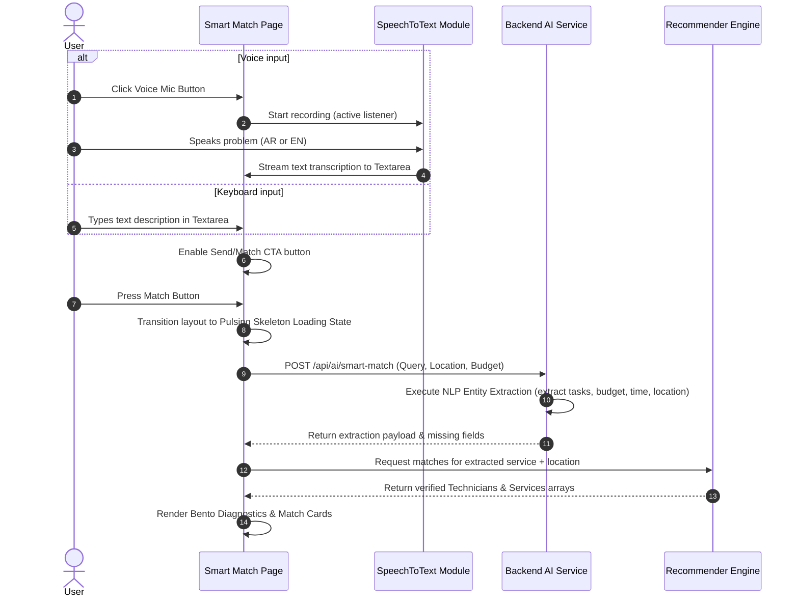
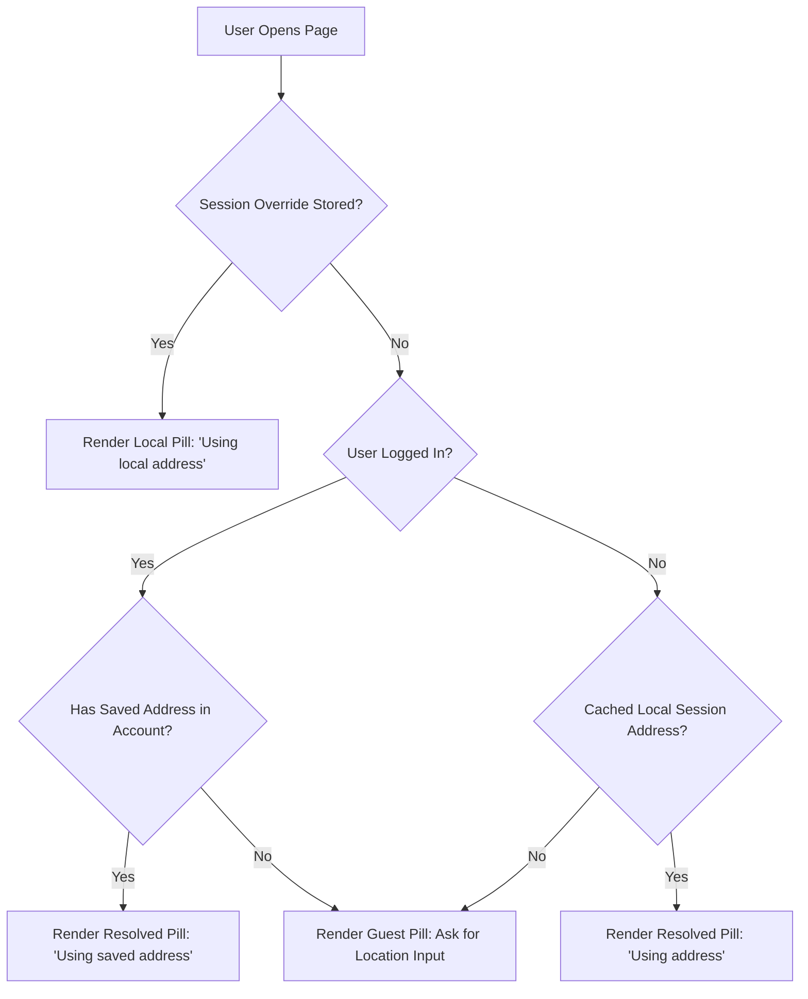

# SERVIO Intelligence — AI Smart Match Page Design

This design document outlines the visual system, architecture, layouts, user flows, and interaction rules for the **AI Smart Match** feature across both the Web (`servio_frontend`) and Mobile (`mobile-app`) platforms. 

---

## 1. Page Overview & Value Proposition

The **AI Smart Match** page is the cognitive center of the SERVIO ecosystem. It enables customers to describe complex home-maintenance problems in natural language (text or voice) without navigating rigid categories. 

The AI extracts **service categories, locations, budget ranges, and urgency**, returning a structured plan that distinguishes immediate hazards from follow-up work (the **Bento Diagnostic**). It then connects users directly with matched elite technicians and services.

### Core Value Pillars
*   **Natural Language Discovery**: Say or type what’s wrong in plain language (e.g., *"My kitchen faucet is dripping and the cabinet underneath is soaked"*).
*   **Bento Diagnostic & Prioritization**: Automatically separates urgent tasks (*"Stop the leak"*) from delayed/maintenance tasks (*"Repair dry rot"*), instructing the user what to book first.
*   **Context-Aware Matching**: Auto-resolves locations from account data, maps budgets, and performs real-time availability lookups.

---

## 2. Visual Tokens & Aesthetic Systems

The visual style embodies a **premium, calm, and trusted home-services marketplace** utilizing glassmorphism, dynamic gradients, and fluid ambient motion.

### 2.1 The Color Palette

Colors are mapped directly from `ServioColors` (`mobile-app/lib/src/design_system/servio_tokens.dart`) and standard SERVIO web stylesheet variables.

#### Light Mode Colors
| Token Name | Hex Value | CSS Variable | Applied Use |
| :--- | :--- | :--- | :--- |
| `backgroundLight` | `#FAF8F5` | `--bg-light` | Page body background (warm, soft beige) |
| `backgroundSoftLight` | `#F3EDE7` | `--bg-soft-light` | Secondary containers, inputs background |
| `surfaceLight` | `#FFFFFF` | `--surface-light` | Standard cards, panels, dialog headers |
| `surfaceAltLight` | `#F7F3EF` | `--surface-alt-light` | Highlighted/nested cards, dropdown lists |
| `textPrimaryLight` | `#222831` | `--text-primary` | Main titles, primary body, button labels |
| `textSecondaryLight`| `#6B6560` | `--text-secondary`| Help text, captions, secondary stats |
| `borderLight` | `#DDD5CC` | `--border` | Dividers, subtle borders, inactive outlines |

#### Dark Mode Colors
| Token Name | Hex Value | CSS Variable | Applied Use |
| :--- | :--- | :--- | :--- |
| `backgroundDark` | `#1A1D23` | `--bg-dark` | Dark theme body background (deep slate) |
| `backgroundSoftDark`| `#262B34` | `--bg-soft-dark` | Inset panels, composer backgrounds |
| `surfaceDark` | `#222831` | `--surface-dark` | Main cards, floating bottom navigation |
| `surfaceAltDark` | `#1E2229` | `--surface-alt-dark` | Deep nested cards, secondary dropdowns |
| `surfaceRaisedDark` | `#2D323B` | `--surface-raised` | Active cards, modal dialogs |
| `textPrimaryDark` | `#E3D5CA` | `--text-primary-dark` | High-contrast copy in dark mode (warm sand) |
| `textSecondaryDark`| `#9A8C73` | `--text-secondary-dark`| Sub-headers, secondary metadata |
| `borderDark` | `#393E46` | `--border-dark` | Dividers, subtle lines, input borders |

#### Brand Accent & Status Colors
| Token Name | Hex Value | Applied Use |
| :--- | :--- | :--- |
| `accent` (Taupe) | `#9A8C73` | Active tabs, key action icons, star ratings, toggle states |
| `accentLight` | `#BFB09A` | Subtle highlights, hover states on taupe containers |
| `neutralWarm` | `#E3D5CA` | Accent panels, pill backgrounds, loading bar tips |
| `deepBrown` | `#3C2415` | Brand anchor (used in headers, dark buttons) |
| `brownLight` | `#5C3D2E` | Secondary CTA button states, dark-theme highlights |
| `navyDark` | `#222831` | Primary CTA backgrounds, dark elements |
| `success` | `#22C55E` | Urgent/Book First badges, active indicators, verified checks |
| `warning` | `#E67E22` | Medium-priority flags, same-day scheduling labels |
| `info` | `#2980B9` | Information alerts, advisory notes |
| `danger` | `#EF4444` | Immediate hazards, error state text/icons |

#### Gradients
*   `ServioGradients.brand` (Linear 135°): `deepBrown` (`#3C2415`) → `navyDark` (`#222831`). Imparts a premium luxury feel for primary headings and hero backdrops.
*   `ServioGradients.brandDark` (Linear 135°): `neutralWarm` (`#E3D5CA`) → `#A68B7B`. For dark-mode reversed brand accents.
*   `ServioGradients.accent` (Linear 90°): `accent` (`#9A8C73`) → `accentLight` (`#BFB09A`). Used in slider rails, secondary headers, and AI spark glow.
*   `ServioGradients.loader`: Multi-color horizontal transition (`deepBrown` → `brownLight` → `accent` → `accentLight` → `neutralWarm`). Defines the primary loader bar.

---

### 2.2 Typography & Hierarchy

Headings utilize **Poppins** (modern, bold, premium) and body elements utilize **Inter** (highly legible, readable at small sizes, excellent Arabic glyph mapping).

```text
Poppins (Headings) + Inter (Body & Inputs)
```

*   **Display Title (Hero)**: Poppins Bold (700) | `3.25rem` / `52px` | Line-height `1.1` | Letter-spacing `-0.02em`
*   **Headline Large (Mobile Hero)**: Poppins SemiBold (600) | `2rem` / `32px` | Line-height `1.2`
*   **Headline Medium (Bento Title)**: Poppins Medium (500) | `1.5rem` / `24px` | Line-height `1.3`
*   **Title Medium (Card Title)**: Poppins Medium (500) | `1.125rem` / `18px` | Line-height `1.4`
*   **Body Medium (Inputs, Descriptions)**: Inter Regular (400) | `1rem` / `16px` | Line-height `1.5` | Letter-spacing `0px`
*   **Label Large (Interactive Pills, Buttons)**: Inter SemiBold (600) | `0.875rem` / `14px` | Line-height `1.2`
*   **Label Small (Micro-meta, Steps)**: Inter Medium (500) | `0.75rem` / `12px` | Line-height `1.1` | Letter-spacing `0.05em` (uppercase)

---

### 2.3 Special Aesthetic Effects (Web vs. Mobile)

#### 1. Aurora Liquid Ribbons (Web Only)
Behind the content sits a CSS-animated liquid background comprising four multi-layered flowing warm bands (`.sm-aurora--1` to `4`) that shift gently in color and orientation, overlaid with a noise texture (`.liquid-grain`) to simulate glassmorphic paper.
```css
.smart-match-liquid-bg {
  position: fixed;
  inset: 0;
  overflow: hidden;
  z-index: -1;
  background: var(--bg-light);
}
.sm-aurora {
  position: absolute;
  filter: blur(140px);
  opacity: 0.28;
  mix-blend-mode: multiply;
  animation: floatAurora 22s infinite ease-in-out alternate;
}
/* Key colors: #F3EDE7, #E3D5CA, #FAF8F5, #BFB09A */
```

#### 2. Orbital AI Mission Control Canvas
A particles backdrop overlay behind the Hero section, displaying floating interactive orbital nodes representing tools, locations, and technicians, drawing together toward the AI Composer.

#### 3. Bottom Navigation Radar Ping (Mobile Only)
The central bottom navigation bar icon for "Smart Match" features a pulsing circular ring behind the icon that expands outward (radar ping) when the screen is inactive, attracting user engagement.

---

## 3. Structural Layouts & Wireframes

### 3.1 Web Desktop Layout

```text
+--------------------------------------------------------------------------+
|  [SERVIO]        Home  Services  [Smart Match]  AI Estimator     [Login] |  <- Site Header
+--------------------------------------------------------------------------+
|                                                                          |
|                             [AI Spark Icon]                              |
|                   Smart matching for real home issues                    |  <- Hero Header
|           Describe the problem. Servio prioritizes it for you.           |
|                                                                          |
|     +--------------------------------------------------------------+     |
|     |  [📍 saved: Nasr City, Cairo                   [Change] ]    |     |  <- Location Pill Row
|     |                                                              |     |
|     |  Describe the work you need - what's wrong, your timing...   |     |  <- Query Textarea
|     |                                                              |     |
|     |  ----------------------------------------------------------  |     |
|     |  Supported criteria: Location, Budget, Urgency...  (🎙️) (⬆️)  |     |  <- Footer Actions
|     +--------------------------------------------------------------+     |
|                                                                          |
+--------------------------------------------------------------------------+
|                                                                          |
|       +------------------------------------+ +--------------------+      |
|       | Step 1 of 2              [URGENT]  | | Insights           |      |  <- Bento Grid
|       | [Droplet] Plumbing                 | | Earliest: Today    |      |     (Diagnostics)
|       | Faucet leak constantly dripping.   | | Budget: Fits 500   |      |
|       +------------------------------------+ +--------------------+      |
|       | Step 2 of 2            [FLEXIBLE]  | | Advisory           |      |
|       | [Hammer] Carpentry                 | | Time missing?      |      |
|       | Replace rotted under-sink wood.    | | [Tomorrow] [ASAP]  |      |
|       +------------------------------------+ +--------------------+      |
|                                                                          |
+--------------------------------------------------------------------------+
|                                                                          |
|   Top Matched Technicians                      Similar Services          |  <- Matches Section
|   +-----------------------+                    +-----------------------+ |
|   | [Pic] Tarek A. (4.9)  |                    | Plumber Callout       | |
|   | Min rate: 150 EGP/hr  |                    | 100 EGP  [Book]       | |
|   +-----------------------+                    +-----------------------+ |
|                                                                          |
+--------------------------------------------------------------------------+
```

---

### 3.2 Mobile Layout Structure

```text
+-----------------------------------+
| <  AI Smart Match                 |  <- App Bar
+-----------------------------------+
|                                   |
|   [ Spark Icon ]                  |
|   Smart matching for              |
|   real home issues                |  <- Mobile Hero
|                                   |
|   +---------------------------+   |
|   | e.g. Kitchen pipe leak... |   |  <- Compact Text Area (Min height: 120px)
|   |                           |   |
|   | (🎙️) (📷)                |   |  <- In-Composer Voice & Camera buttons
|   +---------------------------+   |
|                                   |
|   📍 Service Location             |
|   +---------------------------+   |
|   | Nasr City, Cairo          |   |  <- Location TextField
|   +---------------------------+   |
|                                   |
|   💰 Max Budget (Optional)        |
|   +---------------------------+   |
|   | e.g. 500 EGP              |   |  <- Budget TextField
|   +---------------------------+   |
|                                   |
|   [       Find Matches       ]    |  <- ServioPrimaryButton
|                                   |
|   -----------------------------   |
|                                   |
|   Top Matched Technicians         |  <- Matches Carousel
|   +---------------+ +-----------+ |
|   | Tarek A. 4.9  | | Amr M.    | |
|   | [Book Now]    | | [Book Now]| |
|   +---------------+ +-----------+ |
|                                   |
+-----------------------------------+
```

---

## 4. Component Technical Specifications

### 4.1 The AI Composer & Location Pill
The entry field is an integrated glassmorphic composite box (`.ai-composer`).

*   **Pill Integration**: A dynamic header row containing the resolved/overridden address.
    *   **Loading State**: Displays a pulsing skeleton text with a location pin icon.
    *   **Resolved Address (Authoritative)**: Displays *"Using your saved address: {Address}"* with a `Change` CTA.
    *   **Guest Address (Editable)**: Renders a placeholder text input asking for location.
    *   **Resolved Local (Session)**: Displays *"Using: {Address}"* with a `Save to account` CTA (if logged in) and a `Change` CTA.
*   **Query Input Area**: Large borderless text area (`--text-primary` font, `Inter` `16px`) expanding dynamically based on content.
*   **Actions Row**: Contains the helper meta-text on the left, voice record triggers, and match submission trigger on the right.
    *   **Voice Mic Button**: Pressing once initiates Web Speech API recording; pulses with an overlay ring. Double click switches recording locale to Arabic; triple click forces English.
    *   **Submit button**: Disabled when input is empty. Becomes active (sliding linear gradient highlight) when characters length > 3.

---

### 4.2 Bento Diagnostic Panels
The search results render into a multi-column **Bento Grid** grouping core analysis.

#### Bento Plan Card (`.bento-plan-card`)
Groups divided requirements into sequentially booked steps:
*   **Featured Step (Step 1)**: Visual prominence, takes double width on desktop. Border styled with success colors if urgency is "urgent" or "same_day".
*   **Header**: Step count (*"Step 1 of 2"*) on left; Urgency status pill (`success` = Urgent/Book First, `warning` = Same Day, `info` = Flexible) on right.
*   **Service & Reason**: Displays derived service with standard icon and details illustrating *why* the AI recommends this category.
*   **Selection Border**: Highlighting a card overlays a subtle golden-brown active shadow (`0 0 0 2px var(--accent)`).

#### Bento Insight Strip (`.bento-insight-strip`)
A summary section providing instant confirmation metrics:
*   **Earliest Arrival**: Derived from availability lookup (e.g. "ASAP", "Tonight", "Tomorrow morning").
*   **Budget Fit**: Validates if the matched technicians fall within user’s declared budget ("Within your 500 EGP budget" or "Quote on site").
*   **In your area**: Shows verified local technicians count in proximity.

#### Bento Advisory / Missing Field Row (`.bento-advisory`)
If critical matching context is missing, the page displays a custom troubleshooting strip:
*   **Interactive Suggestion Chips**: Renders dynamic chips. Clicking a chip automatically appends criteria (e.g. adding budget or selecting timing) and re-triggers match logic.
*   **CTA Chips**: `+ Add address` opens a dialog modal for guest checkout.

---

## 5. Detailed Interaction & Data Flows

### 5.1 Query & Entity Extraction Pipeline



---

### 5.2 Location Resolution Logic

To minimize user friction, the platform resolves locations via a tiered fallback system:



---

## 6. Page State Matrix

The UI must adapt dynamically to various API responses and system states:

| UI State | Trigger Condition | Visual Manifestation | Target Component / Action |
| :--- | :--- | :--- | :--- |
| **Default** | Initial page load | Composer is empty. Send button disabled. Active location pill rendered. | Textarea focused. Voice button listening. |
| **Active / Writing** | Length of text > 3 characters | Send button transforms to brand gradient. Meta description hints update. | Send CTA enabled. |
| **Voice Listening** | Voice Mic button clicked | Mic icon changes color, dynamic pulsing ring expands around button. | Voice stream outputs into Textarea. |
| **Loading** | Match button clicked / awaiting API | Hide Composer footer, replace results with custom **ServioSkeleton** blocks. | Disable all interactive inputs. |
| **Success (Matches found)** | API returns steps & technician list | Bento diagnostics expand, Insight strip animates, Technician Carousel populated. | Enable card taps, allow Booking CTAs. |
| **Partial Matches (Advisory)** | API returns list but location/time is missing | Display Bento Advisory container below composer showing missing fields and chip items. | Allow clicking chips to auto-complete request. |
| **Empty State** | API returns 0 technicians/services | Displays fallback illustration: *"We couldn't find matching services. Try adjusting filters or budget"* | "Try adjusting query" secondary action button. |
| **Error / Offline** | API returns 500 error or network lost | Display warning alert banner: *"Smart Match is temporarily unavailable"* | "Try manual search" CTA redirects to Marketplace. |

---

## 7. Localization & Translation (i18n)

The page fully supports **English (EN)** and **Arabic (AR)** configurations, mirroring layouts seamlessly.

```json
{
  "en": {
    "nav_smart_match": "Smart Match",
    "sm_hero_title": "Smart matching for<br><span>real home issues</span>",
    "sm_hero_lead": "Describe the full problem once. Servio separates immediate hazards from follow-up work so you know what to book first, what should happen the same day, and what can wait.",
    "sm_composer_ph": "Describe the work you need — what's wrong, where it is, your timing, and any budget. The more detail, the sharper the match.",
    "sm_criteria": "Supported criteria: Location, Budget, Urgency, Service",
    "sm_voice_label": "Voice input",
    "sm_send_label": "Send",
    "cust_quick_smart_hint": "Opens Smart Match with your last preferences when possible."
  },
  "ar": {
    "nav_smart_match": "المطابقة الذكية",
    "sm_hero_title": "مطابقة ذكية<br><span>لمشاكل المنزل الحقيقية</span>",
    "sm_hero_lead": "اصف المشكلة بالكامل مرة واحدة. يقوم سيرفيو بفصل المخاطر الفورية عن أعمال المتابعة حتى تعرف ما يجب حجزه أولاً، وما يجب إتمامه في نفس اليوم، وما يمكن تأجيله.",
    "sm_composer_ph": "صف العمل الذي تحتاجه — ما هي المشكلة، مكانها، توقيتك، وميزانيتك. كلما زادت التفاصيل، كانت المطابقة أدق.",
    "sm_criteria": "المعايير المدعومة: الموقع، الميزانية، الاستعجال، الخدمة",
    "sm_voice_label": "إدخال صوتي",
    "sm_send_label": "إرسال",
    "cust_quick_smart_hint": "يفتح المطابقة الذكية مع تفضيلاتك الأخيرة عندما يكون ذلك ممكنًا."
  }
}
```

### RTL Design Considerations
*   **Directional Mirroring**: Flex directions, grid layouts, and padding mirror automatically when `<html lang="ar" dir="rtl">` is set.
*   **Icons Swap**: Navigation chevrons (`chevron_right` ➔ `chevron_left`), skip buttons, and text bullet points are reversed. Voice icon remains standard.
*   **Font Weights**: Arabic glyphs render slightly larger in Inter; line heights are increased by `1.15x` to prevent text truncation.

---

## 8. Mobile Responsiveness & Accessibility (a11y)

### 8.1 Accessibility Checklist
1.  **Semantic Elements**: All cards are structured using `<article>`, the insights strip uses `<section aria-label="Quick insights">`, and the form uses `<textarea>` with explicit connected `<label>` tags.
2.  **Keyboard Navigation**: Every plan card has `role="button"` and `tabindex="0"`, responding to `Space` and `Enter` keys for toggling selection.
3.  **Contrast Minimums**: Text combinations (e.g. `textSecondaryLight` on `backgroundLight`) maintain a contrast ratio above **4.5:1** matching WCAG AA standards.
4.  **Tap Targets**: All mobile interactive buttons (Mic, Send, Location pills, Carousel CTAs) maintain a minimum target diameter of **44px × 44px**.

### 8.2 Responsive Layout Rules
*   **Below 768px (Mobile)**: Bento panels stack vertically. Insights strip scales to 1 column. Bottom technician list turns into a horizontal swipe carousel.
*   **768px to 1024px (Tablet)**: Bento panels display as a 2-column layout. Insights strip takes horizontal width above bento items.
*   **Above 1024px (Desktop)**: Full grid layouts enabled. Composer input has max-width `880px` centered. Technicians display in a 3-column row.
